  
 

 

### About Me

- 🔧 Computer engineer building embedded Linux systems end-to-end — bare-metal STM32 drivers, custom Yocto images, and kernels/bootloaders (TF-A, OP-TEE, U-Boot)
- 🤖 Also working with robotics: ROS2, navigation stacks, and Uav autonomous systems
- 🐧 Deep in kernels, bootloaders, and everything that happens before an OS even boots
- 🎓 MSc student in Computer engineering @ VILNIUS TECH
- 📂 All my projects: **[github.com/Abdelrahman-Abdellatif](https://github.com/Abdelrahman-Abdellatif)**
- 📫 Reach me at **abdelrahman0abdellatif@gmail.com**

 

### Connect

 

### Languages & Tools

 

### GitHub Stats

 

